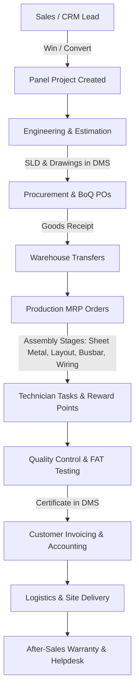

# Al-Masar Switchgear Factory ERP — Deployment & Architecture Guide

A dedicated, self-owned SaaS Factory Management ERP designed for **Al-Masar Switchgear** (Electrical Panel Manufacturing Factory), independent of Odoo, with high-end modern UI, bilingual (English + Arabic) support, and full manufacturing life-cycle automation.

---

## 🏗️ Architecture & Stack

| Layer | Technology | Purpose |
|---|---|---|
| **Frontend / App** | **Next.js 14+ (App Router), React, TypeScript** | High performance UI, server components, bilingual layout (LTR/RTL) |
| **Styling** | **Custom Vanilla CSS Design System** (`globals.css`) | Modern dark glassmorphic design, zero heavy CSS dependencies |
| **Charts & BI** | **Recharts** | Sales Win Rate (pie), Estimation Duration (bar), Production Efficiency (line) |
| **Data & Auth** | **Supabase / PostgreSQL / Cloudflare D1** | Relational schemas, real-time events, RLS policies |
| **Local Runtime** | **Node.js on Windows** | Fast local execution with `run-windows.bat` |
| **Code & Cloud Sync** | **GitHub + Cloudflare Pages / Workers** | Cloud hosting, automated CI/CD and repository versioning |

---

## ⚡ 1. Local Installation on Windows

### Quick Start (One-Click)
1. Double-click **`run-windows.bat`** in the `d:\almasar-erp` folder.
2. The batch script will automatically:
   - Check your Node.js installation
   - Install required packages if needed (`npm install`)
   - Launch your browser to `http://localhost:3000`
   - Run the local Next.js server (`npm run dev`)

### Manual Start via PowerShell / Command Prompt
```powershell
cd d:\almasar-erp
npm install
npm run dev
```

---

## ☁️ 2. Data Management on Cloudflare & GitHub

### GitHub Repository Setup & Versioning
To host your project codebase on GitHub:
1. Open PowerShell in `d:\almasar-erp`:
   ```powershell
   git init
   git add .
   git commit -m "feat: complete Al-Masar Switchgear ERP suite"
   git branch -M main
   git remote add origin https://github.com/YOUR_ORGANIZATION/almasar-switchgear-erp.git
   git push -u origin main
   ```

### Cloudflare Hosting (Cloudflare Pages / Workers)
1. **Connect to Cloudflare Pages**:
   - Log into your [Cloudflare Dashboard](https://dash.cloudflare.com).
   - Go to **Workers & Pages** > **Create application** > **Pages** > **Connect to Git**.
   - Select your GitHub repository `almasar-switchgear-erp`.
   - Set Build Settings:
     - Framework preset: `Next.js`
     - Build command: `npm run build`
     - Output directory: `.next`
2. **Environment Variables**:
   In Cloudflare Pages Settings > Environment Variables, add:
   ```env
   NEXT_PUBLIC_SUPABASE_URL=https://your-project.supabase.co
   NEXT_PUBLIC_SUPABASE_ANON_KEY=your-anon-key
   NEXT_PUBLIC_APP_URL=https://almasar-erp.pages.dev
   ```

### Database Setup (PostgreSQL / Supabase)
1. Open your Supabase SQL Editor.
2. Paste the contents of `d:\almasar-erp\supabase\schema.sql`.
3. Click **Run**. All 15 core factory tables, enum constraints, foreign keys, and the technician points trigger are created instantly.

---

## 🏭 3. Factory Management ERP Workflow (End-to-End)



### Module Highlights:
1. **Sales & CRM (`/crm`)**: Pipeline stages from New Lead to Won Proposition with expected revenue and win probabilities.
2. **Engineering (`/engineering`)**: Electrical schematic reviews, estimation duration tracking, and Monday.com integration links.
3. **Tasks & Production (`/tasks`)**: Detailed technician stage assignments with interactive checklists, color indicators (Green/Red), and instant reward point disbursements.
4. **Procurement (`/procurement`)**: Vendor purchase orders, component pricing, and arrival schedules.
5. **Warehouse (`/warehouse`)**: Incoming stock, internal transfers to production lines, and delivery tracking.
6. **Production MRP (`/production`)**: Manufacturing orders with Bill of Materials (BoM) line checks.
7. **Quality Control (`/qc`)**: Formal Factory Acceptance Testing (FAT), pass/fail sign-offs, and dielectric isolation tests.
8. **Invoicing & Accounting (`/accounting`)**: Customer milestone invoices, vendor bills, 15% VAT calculation, and payment registration.
9. **HR & Payroll (`/hr`)**: Employee directory, monthly salary processing with points-to-cash bonus conversion ($1.50/pt), and printable payslips.
10. **Document Management (`/dms`)**: Centralized repository for Single Line Diagrams (SLD), CAD schematics, BoQs, and FAT certificates with revision control.
11. **Helpdesk & Warranty (`/helpdesk`)**: Post-delivery site intervention, breaker tripping investigation, and warranty ticket management.
12. **Reporting Engine (`/reports`)**: Profitability margins, stage velocity variance, technician performance audit, and CSV export.
